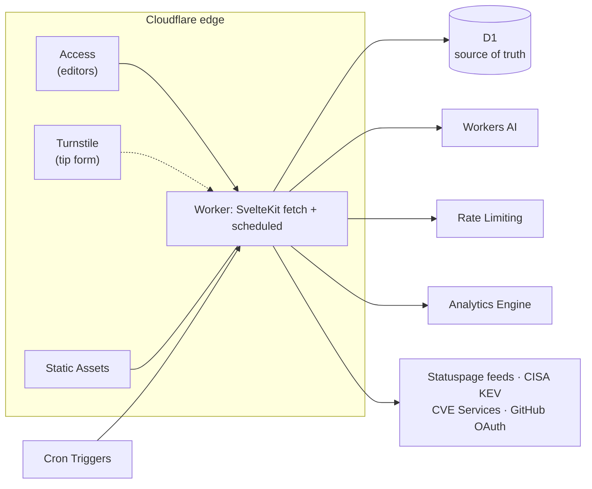

# CyberXmas infrastructure

How the application is built, configured, deployed and operated, and how it grows through the
release phases in [ROADMAP.md](ROADMAP.md). Everything runs as **one Cloudflare Worker**: SvelteKit
serves pages and the JSON API, and the same Worker runs the Cron Trigger jobs.



## Source layout

The project follows the [SvelteKit project structure](https://svelte.dev/docs/kit/project-structure).
Library code lives in `src/lib` and is imported through the `#lib/*` alias declared in
`package.json` `imports`. That alias resolves the same way in Vite, Node.js (tests and scripts),
esbuild (the cron bundle) and TypeScript.

```
src/
├ routes/                    pages and API endpoints (file-based routing)
│ └ api/**/+server.ts        one file per endpoint; re-exports handlers from #lib/server/api
├ hooks.server.ts            builds the request Context into event.locals; handleError
├ params.ts                  route param matchers ([id=id] parses to a number)
├ app.d.ts                   App.Locals, Turnstile window type
└ lib/
  ├ config/                  defaults.ts (every tunable) + index.ts (validated variable loader)
  ├ domain/                  rules and API types shared by server and UI
  │                          (incidents, edition dates, reports, tip sources, community, editorial)
  ├ util/                    pure helpers: encoding, crypto, bounded streams, validation, time zones
  ├ content/                 static UI content: demo stories, source list, door animation text
  ├ components/              Svelte components
  └ server/                  server-only (SvelteKit refuses to bundle it into browser code)
    ├ context.ts             Context, ApiEvent, feature detection
    ├ env.ts                 typed bindings, secrets and variables
    ├ api/                   endpoint logic (public, editorial, tips, community)
    ├ auth/                  editor auth (token / Access) and community sessions
    ├ db/                    every SQL statement, grouped by table
    ├ jobs/                  cron dispatcher, source collection, daily AI review
    ├ http/                  JSON responses, bounded body parsing, cookies
    └ clients/               outbound APIs
      ├ http.ts              timeout, no redirects, User-Agent, bounded bodies
      ├ github.ts · cve.ts · statuspage.ts · cisa-kev.ts
      └ cloudflare/          access.ts · turnstile.ts · workers-ai.ts · rate-limit.ts · analytics.ts
scripts/cloudflare-entry.ts  adds the cron handler to the adapter's Worker (see Build)
migrations/                  D1 schema, applied in order
```

**Dependency rules.** `util` imports nothing else. `config` imports `util`. `domain` imports
`config` and `util`. `components` and `content` may import `domain`, `config` and `util`, never
`server`. Inside `server`: `api` and `jobs` orchestrate; `db` and `clients` never import `api`
or `jobs`. SQL appears only in `server/db`, and a test enforces it (see Security).

**Why there is a build step for cron.** `@sveltejs/adapter-cloudflare` generates only a `fetch`
handler and uploads its output with `no_bundle`. `scripts/cloudflare-entry.ts` uses esbuild to
bundle `src/lib/server/jobs/index.ts` into `cyberxmas-jobs.js` beside the adapter output, then
points `main` at a small entry that exports `{ ...kit, scheduled }`. Durable Object or Workflow
classes would be exported the same way.

## Request flow

1. SvelteKit matches the route. Unknown paths get a 404, and an unsupported method gets a 405
   with an `Allow` header.
2. `hooks.server.ts` `handle` defines `event.locals.ctx` lazily. On first use it builds a
   `Context`: validated config (parsed once per isolate), feature flags derived from bindings and
   secrets, D1, the outbound HTTP client, metrics, and the **edition clock** (now, today and year
   in `EDITION_TIMEZONE`).
3. The `+server.ts` export runs a handler from `#lib/server/api`, which authenticates if needed,
   validates input with `#lib/domain`, and calls `#lib/server/db` and `#lib/server/clients`.
4. Unexpected errors reach `handleError`, which logs them (Workers Logs), counts a
   `request_error` event (Analytics Engine) and returns a generic message.

Scheduled runs build the same `Context` from `controller.scheduledTime`. The cron expression
selects the job from `config.schedule`, and an unknown cron fails loudly rather than defaulting
to a job.

## Cloudflare resources

| Product | Binding / setting | Status | Used for |
|---|---|---|---|
| Workers + Static Assets | `ASSETS` (adapter) | live | SvelteKit pages, API, built assets |
| D1 | `DB` | live | All state: incidents, doors, candidates, tips, sessions, digests, audit |
| Cron Triggers | `triggers.crons` | live | `CRON_COLLECT` source collection, `CRON_AI_REVIEW` shortlist |
| Workers AI | `AI` | live (off by default) | Daily editor shortlist, JSON-schema constrained |
| Rate Limiting | `TIP_LIMIT`, `REVIEW_LIMIT` | live | Tip submissions per account/IP, votes per account |
| Turnstile | `TURNSTILE_SITE_KEY` + secret | live | Bot check on tip submission (siteverify with `remoteip`) |
| Access | `EDITORIAL_AUTH`, `ACCESS_*` | **new** | Per-editor identity for `/editorial` and `/api/editorial` |
| Analytics Engine | `METRICS` → `cyberxmas_events` | **new** | Job runs, per-source failures, request errors |
| Workers Logs | `observability.enabled` | **new** | `console.*` output and exceptions |
| Custom Domain | `routes` (`custom_domain`) | live | `cyberxmas.com`, production only; the zone must be on Cloudflare |
| Cache API or KV | `CACHE` (KV) | phase 2 | Cache public reads keyed by edition day; purge on publish |
| Queues | `COLLECT_QUEUE` | phase 2 | One message per source: retries, backoff, dead-letter queue |
| Workflows | `SELECTION` | phase 2 | Durable daily selection: rank, fallback, schedule, alert |
| Email Service | `send_email` | phase 2 | Alert editors about failing sources, empty doors, AI failures |
| R2 | `MEDIA` | phase 4 | Approved images and generated share graphics |
| Secrets Store | none yet | optional | Share `GITHUB_CLIENT_SECRET` and similar across environments |

Each planned resource is added only when its feature lands, because each needs an account
resource ID and a change in behaviour. The adoption rules:

- **Cache (in use).** `server/http/cache.ts` keeps the public GET endpoints (edition, feed,
  report) in the Cache API for `PUBLIC_CACHE_SECONDS` (60) and in browsers for 30 seconds, never
  past the edition's next midnight, so a newly opened door is never hidden behind a cached
  response. Editorial writes do not purge it: a published or withdrawn report shows up within a
  minute. Only 200 responses are stored; tips, sign-in and the desk stay `no-store`. The Cache
  API works on the custom domain only, so on workers.dev every request reaches D1. D1 stays the
  source of truth.
- **Queues (phase 2).** Add them when collectors exceed what one cron invocation can do (more
  sources, NVD paging). `jobs/collect.ts` already isolates each source, so each becomes one
  message.
- **Workflows (phase 2).** Use them for automatic daily selection with the quiet-day fallback
  chain. Each step is idempotent and writes an audit event. They never publish unreviewed
  material.
- **Email (phase 2).** Send alerts only to verified editor addresses. Alerts carry no tip
  bodies or user identities.

## Configuration

Configuration has four kinds, kept apart on purpose:

1. **Code defaults.** `src/lib/config/defaults.ts` holds every tunable: limits, sizes, timeouts,
   page sizes, AI model and caps, cron schedule. Change these by code review.
2. **Variables.** Plain-text `vars` in `wrangler.jsonc`, parsed and validated by
   `src/lib/config/index.ts`. An invalid value keeps its default and logs a warning once per
   isolate. `pnpm test` checks that `wrangler.jsonc` is valid, that its crons match the jobs,
   and that every variable is documented below.
3. **Secrets.** `wrangler secret put` in production, the ignored `.dev.vars` locally. They are
   never part of `Config`, so config can be logged safely.
4. **Bindings.** Declared in `wrangler.jsonc` and typed in `src/lib/server/env.ts`. A missing
   optional binding turns its feature off instead of failing requests.

### Variables

| Variable | Default | Purpose |
|---|---|---|
| `EDITION_TIMEZONE` | `UTC` | IANA zone in which each door opens at midnight. It drives the API embargo, scheduling, and the UI countdown and labels. Choose it before the first December edition; changing it mid-edition moves unopened doors. |
| `EDITORIAL_AUTH` | `token` | `token` uses the shared `EDITOR_TOKEN`. `access` uses a Cloudflare Access JWT. `access_and_token` requires both. |
| `ACCESS_TEAM_DOMAIN` | unset | `<team>.cloudflareaccess.com`, used to fetch signing keys and check `iss`. |
| `ACCESS_AUD` | unset | The Access application's Audience tag, checked against `aud`. |
| `COLLECTOR_SOURCES` | `cloudflare,github,cisa` | Collectors run by `CRON_COLLECT`. Empty runs none. |
| `COLLECTOR_MAX_CANDIDATES` | `50` | Newest candidates stored per source per run. |
| `AI_REVIEW_ENABLED` | `false` | Runs the daily shortlist when the `AI` binding is present. |
| `AI_REVIEW_MODEL` | `@cf/meta/llama-3.3-70b-instruct-fp8-fast` | Workers AI model; it must support JSON-schema output. |
| `AI_REVIEW_MAX_TIPS` | `40` | Untriaged public tips per review (oldest first). |
| `AI_REVIEW_MAX_CANDIDATES` | `60` | Imported leads per review (most severe first). |
| `AI_REVIEW_LOOKBACK_DAYS` | `3` | Age limit for imported leads in the review. |
| `EDITION_DATE_SHIFT_DAYS` | `0` | Preview only: run the edition clock this many days ahead. Leave unset in production. |
| `EDITION_TIME_TRAVEL` | `false` | Preview only: `true` adds a time machine to the preview banner, so each visitor can pick the edition date. Turns caching off. Never set it in production. |
| `SEARCH_INDEXING` | `true` | `false` serves a disallow-all `robots.txt` and `X-Robots-Tag: noindex`. Set on the preview. |
| `PUBLIC_CACHE_SECONDS` | `60` | Edge cache lifetime for public API responses (custom domain only). `0` turns it off. |
| `COMMUNITY_SESSION_DAYS` | `7` | GitHub sign-in session lifetime. |
| `CRON_COLLECT` | `0 * * * *` | Must also appear in `triggers.crons`. |
| `CRON_AI_REVIEW` | `15 6 * * *` | Must also appear in `triggers.crons`. |
| `GITHUB_CLIENT_ID` | unset | Public OAuth client ID. Sign-in is off until it and the secret are set. |
| `TURNSTILE_SITE_KEY` | unset | Public widget key. Tip submission is off until it, the secret and `TIP_LIMIT` exist. |

### Secrets

| Secret | Enables |
|---|---|
| `EDITOR_TOKEN` | Editorial API in `token` modes. At least 32 random characters. |
| `GITHUB_CLIENT_SECRET` | GitHub sign-in (with `GITHUB_CLIENT_ID`). |
| `TURNSTILE_SECRET` | Tip submission (with `TURNSTILE_SITE_KEY` and `TIP_LIMIT`). |

### Features and what turns them on

| Feature | Requires |
|---|---|
| Public calendar, feed, reports | `DB` |
| Community sign-in | `GITHUB_CLIENT_ID`, `GITHUB_CLIENT_SECRET` |
| Tip submission | sign-in + `TIP_LIMIT` + `TURNSTILE_SITE_KEY` + `TURNSTILE_SECRET` |
| Tip likes | sign-in + `REVIEW_LIMIT` |
| Editorial desk | `EDITOR_TOKEN` and/or `ACCESS_TEAM_DOMAIN` + `ACCESS_AUD`, per `EDITORIAL_AUTH` |
| Daily AI shortlist | `AI_REVIEW_ENABLED=true` + `AI` |
| Metrics | `METRICS` |

### Moving editors to Cloudflare Access

1. In Zero Trust, create a self-hosted Access application for `cyberxmas.com/editorial*` and
   `cyberxmas.com/api/editorial*`, with a policy for the editors' identities.
2. Copy its Audience tag. Set `ACCESS_TEAM_DOMAIN`, `ACCESS_AUD` and
   `EDITORIAL_AUTH=access_and_token`. Deploy, then confirm the desk opens with the key.
3. Switch to `EDITORIAL_AUTH=access` and delete `EDITOR_TOKEN`. The desk now shows each
   editor's email, and the shared key is gone.

The Worker verifies the `Cf-Access-Jwt-Assertion` signature, issuer, audience and expiry itself,
so requests that bypass Access (for example a `workers.dev` URL) are still rejected. Disable
`workers_dev` in production as well.

## Environments

| | Local | Preview | Production |
|---|---|---|---|
| Run | `pnpm dev` (UI, demo data) · `pnpm preview` (full Worker) | `pnpm deploy:preview` | `pnpm deploy` |
| Worker | local | `cyberxmas-preview` (workers.dev) | `cyberxmas` |
| D1 | `.wrangler/state` via `pnpm db:local` | separate `cyberxmas-preview` database | `cyberxmas` |
| Secrets | `.dev.vars` | `wrangler secret put EDITOR_TOKEN --name cyberxmas-preview` | `wrangler secret put` |
| Editorial sign-in | `EDITORIAL_AUTH=token` | `EDITORIAL_AUTH=token` | token, later Access |
| GitHub sign-in | local callback app | off (no `GITHUB_CLIENT_ID`) | `cyberxmas.com` callback |
| Edition clock | real | 11 days ahead, or any date from the time machine | real |

The preview is `env.preview` in `wrangler.jsonc`. It collects the real sources hourly into its own
database and runs the edition clock ahead, so the desk can draft and publish doors before
December without touching production. Only the edition clock moves: collection, sessions and
audit timestamps use real time. With `EDITION_TIME_TRAVEL=true` the banner has a time machine: it
sets the `cyberxmas-date` cookie, and the server then runs that visitor's edition clock on the chosen
date, so doors, embargo, countdowns and the desk's scheduling rules all behave as on that day.
Public responses are not cached while time travel is on. `scripts/deploy-preview.ts` builds with `CLOUDFLARE_ENV=preview`
(the adapter then writes the preview's bindings into its generated config), applies the preview's
migrations and deploys. After it runs, the build output belongs to the preview, so always deploy
production with `pnpm deploy`, which rebuilds.

## Build, CI and deployment

- `pnpm check` runs `svelte-kit sync` and `svelte-check` (strict TypeScript, including
  components).
- `pnpm test` runs Node's test runner directly on TypeScript (Node 22.18 and later strip types
  natively). D1 is replaced by `node:sqlite` with every migration applied.
- `pnpm build` runs `vite build` and then `scripts/cloudflare-entry.ts`.
- CI (`.github/workflows/ci.yml`) runs check, test and build on Node 22/24/26. On Node 26 it
  also smoke-tests the packaged Worker against an empty local D1 and runs
  `wrangler deploy --dry-run`. CI holds no Cloudflare credentials and never deploys.
- Release order: apply migrations (`wrangler d1 migrations apply DB --remote`), then deploy.
  Migrations must stay backwards compatible with the version already running.
- Rollback: `wrangler rollback` for code, and D1 Time Travel (`wrangler d1 time-travel restore`)
  for data within its retention window.

## Data roadmap

Current tables: `incidents`, `calendar_entries`, `editorial_events` (filled by triggers),
`editorial_candidates`, `editorial_source_state`, `community_tips`, `community_tip_likes`,
`community_sessions`, `editorial_ai_digests`.

Next migrations, in order:

1. `editorial_events.actor`. The triggers cannot see who acted, so write audit rows from
   `api/editorial.ts` with the editor's name (available now that Access identifies editors), and
   keep the triggers as a backstop.
2. `evidence` (incident_id, url, kind, verification) and `sources`: one canonical incident with
   many evidence records, as ROADMAP.md describes, plus a `verification` column on `incidents`.
3. Expiry of `community_sessions` and old digests, by a cleanup step in the hourly job.
4. Votes by type, the reputation ledger and roles (phases 3 and 4).

## Security model

- **SQL injection.** Every value is passed with `.bind()`. Template literals splice in only
  fixed SQL fragments that are module constants (column lists, the publication predicate,
  ordering). Search uses `instr()` on a bound value, so there are no `LIKE` wildcards. `ORDER BY`
  is never caller-chosen text, and `LIMIT`/`OFFSET` are bound integers.
  `db/sql-safety.test.ts` fails the build if `.prepare(` appears outside `src/lib/server/db`, or
  if a db module interpolates anything but a constant fragment.
- **Embargo.** Visibility is decided in SQL for every public read (calendar, feed, detail),
  never in Svelte. Scheduled doors get `published_at` set to the door's opening instant in the
  edition time zone.
- **Authentication.** Editors use an Access JWT verified in the Worker, a constant-time bearer
  token comparison, or both. Community members use a GitHub OAuth flow with PKCE and state, and
  a random session token stored hashed in a `__Host-` cookie. State-changing community requests
  require a same-origin `Origin` header.
- **Outbound requests (SSRF).** The Worker never fetches a user-supplied URL. Collectors use
  fixed origins, and every request goes through `clients/http.ts`: no redirects, a timeout, and
  size-bounded bodies. CVE IDs are validated before they are placed in URLs.
- **Untrusted text.** Svelte renders all feed and user text as text. Source links must be HTTPS
  and free of credentials. The AI prompt treats rows as data, and its output is limited to
  supplied IDs and a fixed list of reasons.
- **Transport.** Every response sends HSTS for a year (pages from `hooks.server.ts`,
  static files from `_headers`). The HTTP to HTTPS redirect is the zone's Always Use HTTPS
  setting, which must stay on.
- **Abuse.** Rate limits, Turnstile bound to hostname and action, canonical-source
  deduplication, and no IP addresses stored in D1.

## Observability

- **Workers Logs** (`observability.enabled`) capture `console.error` from `handleError`, job
  failures and invalid-variable warnings.
- **Analytics Engine** dataset `cyberxmas_events`: `index1` is the event, `blob1` the event,
  `blob2` the label, `blob3` the status, and `double1` onwards the values. Events:
  - `collection` (label: source, status: `ok`/`error`, double1: candidates)
  - `ai_review` (status, double1: rows considered, double2: suggestions)
  - `request_error` (label: route ID)

  Example query (SQL API):

  ```sql
  SELECT blob2 AS source, blob3 AS status, SUM(_sample_interval) AS runs
  FROM cyberxmas_events
  WHERE blob1 = 'collection' AND timestamp > NOW() - INTERVAL '1' DAY
  GROUP BY source, status
  ```
- **Alerting (phase 2).** A scheduled check emails editors when a source has failed for 6
  consecutive hours, when tomorrow's door is empty after 18:00 edition time, or when the AI
  review fails.

## Next steps

1. **SvelteKit-native data loading.** Public pages currently render on the client and fetch the
   JSON API. Move them to `+page.server.ts` `load` functions that share code with the API
   handlers and stream the slower sections, so pages render on the server. Move the tip form and
   editorial actions to remote functions (`form` / `command` in `*.remote.ts`). Keep the JSON
   endpoints as the public API.
2. The `editorial_events.actor` migration.
3. Phase 2 resources (Queues, Workflows, Email) as their features are built.
